<picture>
  <source media="(prefers-color-scheme: dark)" srcset="./dark.svg">
  <source media="(prefers-color-scheme: light)" srcset="./light.svg">
  
</picture>

## Merhaba, ben Beyza 👋

Karadeniz Teknik Üniversitesi **Yönetim Bilişim Sistemleri** 4. sınıf öğrencisiyim. Veri analizi ve veri bilimiyle ilgileniyorum: veriyi toplayıp temizliyor, Python ile analiz ediyor, makine öğrenmesi modelleri kuruyor ve sonuçları **Power BI** panolarına dönüştürüyorum.

> 🔎 **Veri analisti / iş zekâsı** alanında staj ve iş fırsatlarına açığım.

## Odak

- **Veri analizi** — veri çekme, temizleme ve keşifsel analiz (Python, pandas)
- **İş zekâsı** — Power BI panoları, veri modeli, DAX ölçüleri ve Power Query
- **Makine öğrenmesi** — sınıflandırma modelleri, model karşılaştırma ve değerlendirme (scikit-learn)
- **Risk skorlama** — birden çok kaynaktan gelen veriyi birleştirip karar destek skorları üretme

## Eğitim & Topluluk

| | |
|---|---|
| 🎓 **Karadeniz Teknik Üniversitesi** | Yönetim Bilişim Sistemleri · Lisans (2023 – ) |
| 🤝 **Türkiye Veri Topluluğu** | Üniversite Elçisi (Eylül 2026 – ) |

## Öne Çıkan Projeler

### 📊 Veri Analizi & İş Zekâsı

| Proje | Açıklama | Teknolojiler |
|---|---|---|
| [**Türkiye Enerji İthalatı Analizi**](https://github.com/BeyzaaNuur/enerji_proje) | 1980–2024 kömür, gaz ve petrol ürünleri ithalatında tedarikçi ülke bağımlılığı; HHI ile yoğunlaşma riski, risk skorlama ve cari açığa etkisi | Python · Power BI |
| [**Türkiye Deprem Risk Modeli**](https://github.com/BeyzaaNuur/deprem-risk-model) | AFAD/USGS deprem, TÜİK nüfus-bina ve DASK sigorta verisini il bazında birleştiren çok bileşenli risk skoru — ekip projesi, proje yürütücüsü | Python · Power BI |
| [**Walmart Sales Dashboard**](https://github.com/BeyzaaNuur/walmart-sales-dashboard) | 45 mağaza × 143 haftalık satış verisiyle satış, mağaza performansı ve makroekonomik ilişkiler panosu | Power BI · DAX · Power Query |
| [**Maven Roasters Satış Analizi**](https://github.com/BeyzaaNuur/maven-roasters-dashboard) | 149 bin işlemlik kahve zinciri verisiyle günlük satış analizi panosu | Power BI · DAX · Power Query |

### 🤖 Makine Öğrenmesi

| Proje | Açıklama | Teknolojiler |
|---|---|---|
| [**Telco Churn Tahmini**](https://github.com/BeyzaaNuur/telco-churn-tahmini) | IBM Telco verisiyle (7.043 müşteri) ayrılma riski taşıyan müşterileri tespit; k-NN, Karar Ağacı ve Random Forest karşılaştırması | Python · pandas · scikit-learn |
| [**Meme Kanseri Sınıflandırması**](https://github.com/BeyzaaNuur/breast-cancer-classification) | Tümörleri iyi/kötü huylu olarak sınıflandırma; veri sızıntısını önleyen ölçekleme ve Recall odaklı model seçimi | Python · scikit-learn |

### 🌐 Web

| Proje | Açıklama | Teknolojiler |
|---|---|---|
| [**yenikariyerim**](https://github.com/BeyzaaNuur/yenikariyerim) | Kayıt/giriş, ilan arama, kategori filtresi ve ilan yönetimi olan iş ilanı platformu | PHP · MySQL |
| [**Yeşil Rehber (Flora Bilgi Sistemi)**](https://github.com/BeyzaaNuur/flora-bilgi-sistem-tasar-m-) | Ağaç, çiçek ve mantar türlerini bölgelere göre (Türkiye, Amerika) tanıtan; giriş/kayıt ve dashboard sayfaları olan web uygulaması | HTML · SCSS · JavaScript · Bootstrap 5 |

## Teknolojiler

| Alan | Araçlar |
|---|---|
| **Diller** | Python · SQL · C# · PHP |
| **Veri & ML** | pandas · NumPy · scikit-learn · Jupyter · Google Colab |
| **İş Zekâsı** | Power BI · DAX · Power Query |
| **Veritabanı** | SQL Server · MySQL |

## GitHub Aktivitesi

<picture>
  <source media="(prefers-color-scheme: dark)" srcset="https://github-readme-stats.vercel.app/api?username=BeyzaaNuur&show_icons=true&hide_border=true&bg_color=0B1220&title_color=22D3EE&icon_color=A78BFA&text_color=CBD5E1">
  <source media="(prefers-color-scheme: light)" srcset="https://github-readme-stats.vercel.app/api?username=BeyzaaNuur&show_icons=true&hide_border=true&bg_color=F8FAFC&title_color=0369A1&icon_color=6D28D9&text_color=334155">
  
</picture>

## İletişim

